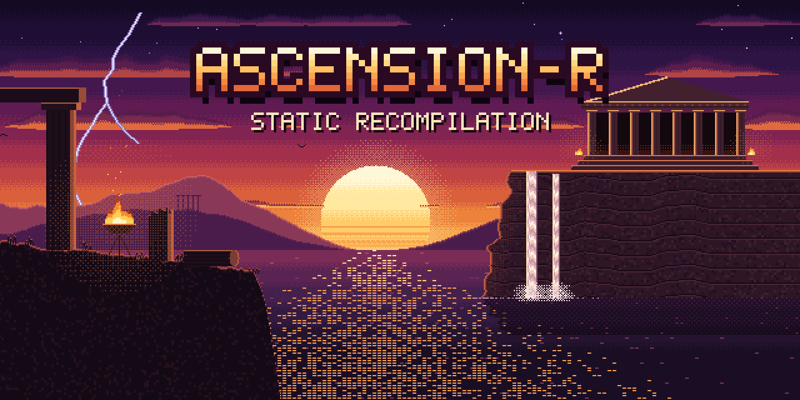

<p align="center"></p>

# Ascension-R: a God of War: Ascension PC port

[](https://github.com/rigaz29/Ascension-R/actions/workflows/ci.yml)
[](LICENSE)


<a href="https://recomplauncher.com/game/ascension-r"><picture><source media="(prefers-color-scheme: dark)" srcset="https://recomplauncher.com/assets/press/launcher/badge-light.svg"></picture></a>

An unofficial, native PC port of **God of War: Ascension** (PS3) for Windows, made by static recompilation with
[ps3recomp](https://github.com/sp00nznet/ps3recomp). The game's PPU and SPU code is translated to x86-64 ahead of time and the RSX
is drawn with Direct3D 12, so no emulator runs while you play.

Website: [rigaz29.github.io/Ascension-R](https://rigaz29.github.io/Ascension-R/)

> [!IMPORTANT]
> This repository holds no game files. You build the port from your own copy of the game. See [Legal](#legal).

## Contents

- [Status](#status)
- [Features](#features)
- [Download](#download)
- [What you need](#what-you-need)
- [Building from source](#building-from-source)
- [Playing](#playing)
- [Reporting a problem](#reporting-a-problem)
- [How it works](#how-it-works)
- [Project layout](#project-layout)
- [Contributing](#contributing)
- [FAQ](#faq)
- [Legal](#legal)
- [Credits](#credits)
- [License](#license)

## Status

It boots, plays the cinematics and goes through the menus into the levels. It has not been played from start to finish, so expect
problems further in.

- **Game:** God of War: Ascension at version 1.12: the digital US release NPUA80918, or the European disc BCES01741 or
  the US disc BCUS98232 with its updates installed in RPCS3 (the Asian disc BCAS25016 too, from the next release). Each
  needs the game and its updates 1.04 to 1.12.
- **Platform:** Windows 10 or 11, 64-bit. Tested on Windows 11.
- **Speed:** above 30 frames a second in the two scenes measured, a fight of the first level and the gate, on a Ryzen 5 4600H with
  a GTX 1650 Ti and the Smooth preset.
- **Online:** not supported. The port is single player.
- **Downloads:** the Kit, on the [releases page](https://github.com/rigaz29/Ascension-R/releases). It holds none of the game's code
  and builds it on your PC from your copy.

## Features

- **Launcher:** a ready check, three presets (Smooth, Balanced, Faithful) and every setting below. It finds the game's folder by
  itself, and says when a newer release is out, with a link to it.
- **Picture:** internal resolution from 1x to 4x or native, AMD FSR 1 and AMD FSR scaling (FSR 4.1 on AMD Radeon RX 6000 and
  newer, FSR 3.1 on other cards), frame generation by AMD FSR or, in beta, by ANR FG (see the FAQ), SMAA 1x and
  anisotropic filtering.
- **Display:** windowed or borderless, ultrawide, VSync, a frame rate cap, and the frame rate on screen.
- **Shaders:** a compressed cache, pipelines built before the title, every vertex shader built before the first start
  of each version, on an 8-bit screen with music of its own, and the pixel shaders of the game's files built ahead from
  the launcher (Build all shaders now).
- **Game patches:** switch off MLAA, depth of field, motion blur, mesh trimming or dynamic shadows.
- **Cheats:** damage to and from Kratos, max red orbs, infinite magic and items, infinite rage and double jumps.
- **Controls:** a controller or keyboard and mouse. Xbox and other XInput pads, and through SDL3 the DualShock 4, the
  DualSense, Switch controllers and many others; stick dead zone, confirm button, vibration and controller API settings,
  and Xbox button icons in place of the PlayStation ones, by choice or for an Xbox controller.
- **Trophies:** read from the game's own trophy list, in the game's language. A notice over the picture for each one
  won, a Trophies page in the launcher, and the platinum once every single-player trophy is won.
- **Saves:** backups kept before the game writes over a save.
- **Mods:** a `mods` folder beside the program. A mod's folder or `.zip` dropped in shows on the
  launcher's Mods tab, where each one is switched on or off and ordered. Its files are read in place of the game's,
  files inside the game's archives and lines of its text go in as one more update, and its pictures take the place of
  the game's textures; the game's own folder is never changed ([docs/MODDING.md](docs/MODDING.md)).
- **Problem reports:** one button makes a zip of the logs, with your paths hidden.

[docs/FEATURES.md](docs/FEATURES.md) describes each one and its setting.

## Download

The [releases page](https://github.com/rigaz29/Ascension-R/releases) has the Kit: a zip of the program without the game's code.
Its launcher finds your copy of the game, decrypts it with RPCS3 and builds the game's code on your PC, once, in about ten minutes.
There is nothing else to install: the Kit brings its own Python and LLVM. Each release's notes have the steps.

[RecompLauncher](https://recomplauncher.com/game/ascension-r) installs and updates the same Kit, and shows the settings on
the game's page. Its Play goes straight into the game once the launcher above has set it up; hold Shift to see that
launcher again.
Optimise for this PC (System tab, off at first) has the build train on your PC first, with the game playing its opening by
itself, and optimize with what it counted: 2-3% more frames, for about 15 minutes more.

Your copy needs all nine of the game's updates, 1.04 to 1.12, installed in RPCS3 in that order. Each brings its own files:
1.12's is the EBOOT alone, and the archives come with the ones before it. With 1.12 alone the game stops on its first
loading screen.

The European disc (BCES01741) runs from two folders: a decrypted dump of the disc, unpacked into a folder (an ISO has to be
opened and copied out first), and its updates installed in RPCS3, which puts them in `dev_hdd0\game\BCES01741`. The
launcher finds the two together, and decrypts the update's GOWA.SELF with no `.rap`: the key is in the update's own
EBOOT.BIN, which it hands to RPCS3. Both releases run the same GOWA.elf at 1.12, byte for byte, so the same game code.
The US disc (BCUS98232) is taken the same way, its updates in `dev_hdd0\game\BCUS98232`: its update is the European
disc's (the same PPU cache folders in RPCS3, [#4](https://github.com/rigaz29/Ascension-R/issues/4)). So is the Asian
disc (BCAS25016) from the next release, its updates in `dev_hdd0\game\BCAS25016`. The files of these two are not
checked yet, as a list of them is not in the port.

## What you need

To build it from source:

- Windows 10 or 11, 64-bit.
- A CPU with AVX2 and FMA, and a GPU with Direct3D 12.
- The game, installed in RPCS3 with its license, and its updates 1.04 to 1.12, installed in that order.
- Python 3.10 or later, Git, CMake, Ninja, Visual Studio with "C++ Clang Compiler for Windows", a Windows SDK, and about 20 GB free.
- For the game's movies: an LGPL shared build of FFmpeg with its headers, unpacked under `..\ffmpeg`, for example
  `win64-lgpl-shared` from [BtbN/FFmpeg-Builds](https://github.com/BtbN/FFmpeg-Builds/releases).
- Optional, for AMD FSR 4.1 and 3.1: [FSR SDK 2.4.0](https://github.com/GPUOpen-LibrariesAndSDKs/FidelityFX-SDK), unpacked under
  `..\fsr-sdk`.

## Building from source

```
git clone --recursive https://github.com/rigaz29/Ascension-R
cd Ascension-R
python -m venv ..\.venv
..\.venv\Scripts\pip install -r ps3recomp\requirements.txt

# 1. Decrypt USRDIR\GOWA.SELF to GOWA.elf with RPCS3 (Utilities > Decrypt PS3 Binaries).
# 2. Point the project at the installed game. It is only read.
..\.venv\Scripts\python scripts\gowa.py setup --game-dir <RPCS3>\dev_hdd0\game\NPUA80918
..\.venv\Scripts\python scripts\gowa.py doctor
..\.venv\Scripts\python scripts\gowa.py analyze
..\.venv\Scripts\python scripts\gowa.py lift
..\.venv\Scripts\python scripts\gowa.py build
..\.venv\Scripts\python scripts\gowa.py run
```

`doctor` lists anything that is missing. The lift and the first build take about 13 minutes on a Ryzen 5 4600H. `run` starts the
game straight away, with its log in `logs\`.

## Playing

Open `build\Ascension-R.exe`. The launcher checks the game's folder and your setup, and **Play** starts the game.

The first start of each version builds the game's vertex shaders before the game begins, on a screen of its own: a
minute or two the first time, seconds after an update. Then the same screen builds the pixel shaders of the game's
files, some 7 minutes on six cores the first time: **Enter** or a controller's **Start** leaves the rest for the next
start, or for **Build all shaders now** in the launcher's sidebar (Build on the Play tab). The few it cannot build come
the first time they are needed. **Clear shaders**, in the launcher's sidebar, makes the next start build them again.

A build from source keeps its settings, logs and shader caches in `build\`, and its saves in `gamedata\`.

## Reporting a problem

**Report a problem**, in the launcher's sidebar, makes a zip in `logs\` beside the settings file, for you to attach to an
[issue](https://github.com/rigaz29/Ascension-R/issues/new?template=problem.yml). The launcher offers it by itself after a session
that crashed, lost the graphics device, froze or stopped with no reason in its log. `Ascension-R --report [--with-saves]` makes one
without the window.

The zip holds the logs and pad recordings of the last three sessions the game ran in, your settings, the build, your hardware and
driver versions, and Windows' records of crashes and hangs of this exe in the last two weeks. Folder paths and your Windows account
and PC names are hidden. The game sends nothing by itself and no game file goes in. Saves go in only if you tick the box, without
the game's images and sounds; with them go the backups (Save backups, in the System tab) that hold your saves as each of those
sessions found them, so that a session can be played again here from where it started.

If no new frame comes for 15 seconds, the log gets what each thread was doing, and again at 60 (`GOWA_FREEZE_WATCH=<seconds>`,
`0` = off).

## How it works

1. `gowa.py lift` translates the PPU code of `GOWA.elf` to C++, and `build` does the same to C for the SPU programs and job modules.
   Both are compiled for x86-64 with clang-cl.
2. The [ps3recomp](https://github.com/sp00nznet/ps3recomp) runtime stands in for the PS3: its system calls and libraries, SPURS, the
   file system, audio, pads and save data.
3. The game's RSX commands are drawn with Direct3D 12. Its shaders are translated to HLSL and compiled with DXC.
4. Movies are decoded with FFmpeg.
5. SPU code that was not translated ahead of time runs in an interpreter. The session records it, and the next `lift` adds it.

More detail: [what the game is made of](docs/ANALYSIS.md), [what has been measured](docs/PERF.md), and the
[development notes](docs/notes), one per session.

## Project layout

```
port/          the port: entry point, launcher, game-specific code
native/        hand-written routines for the SPU code that costs the most
scripts/       gowa.py, the pipeline (doctor, setup, analyze, lift, build, run, symbolize), and the bench
tools/         which of the game's imports the runtime answers, shader cache checks, RenderDoc helpers
tests/         tests for the launcher's game search, shader compile guards and native routines
docs/          analysis, measurements, features and development notes
packaging/     text files that go beside the program in a package
site/          the website, rigaz29.github.io/Ascension-R, published by .github/workflows/pages.yml
third_party/   zlib
ps3recomp/     the toolkit and runtime, as a submodule (fork rigaz29/ps3recomp, branch gowa)
```

## Contributing

Anyone can help: by playing and reporting, or with changes to the port or to the runtime under it.
[CONTRIBUTING.md](CONTRIBUTING.md) says where help is most useful, where a change goes, and what must never be committed.

## FAQ

### Is there an official PC version of God of War: Ascension?

No. It came out on PlayStation 3 only. Ascension-R is an unofficial fan project, not affiliated with or endorsed by Sony.

### How is this different from playing on RPCS3?

RPCS3 emulates the PS3 and runs the game's code as it goes. Ascension-R translates that code to native x86-64 code ahead of time,
on your PC, and draws with Direct3D 12, so no emulator runs while you play. RPCS3 is used only to decrypt your copy.

### Do I need to own the game?

Yes. The download holds no code or assets of the game: its launcher builds the game's code from your own copy, with its license.

### Which copies of the game work?

At version 1.12, with every update from 1.04 installed:

| Release | Id | |
|---|---|---|
| Digital, US | NPUA80918 | supported |
| Disc, Europe and Australia | BCES01741 | supported: a decrypted dump of the disc, its updates in RPCS3 |
| Disc, US | BCUS98232 | supported, as the European disc: a decrypted dump of the disc, its updates in RPCS3 |
| Disc, Asia | BCAS25016 | in the next release (a build from source has it): as the European disc |
| Digital, Europe, and the others | | not yet |

For a copy that is not supported yet, its serial and version (RPCS3's game list shows both) in
[#4](https://github.com/rigaz29/Ascension-R/issues/4) help add it.

### Does it run on Linux or the Steam Deck?

One player plays it on Linux through Proton, in a Wine prefix made by Lutris
([#12](https://github.com/rigaz29/Ascension-R/issues/12)). The Steam Deck has not been tried.

### Does it run on a Mac?

Not yet. This fork is being brought to Apple Silicon Macs: it builds there, with ps3recomp's Metal backend, but has
not run the game on a Mac yet. [docs/MACOS.md](docs/MACOS.md) has the state, how to build it and what is left.

### Can I use mods?

Yes: put a mod's folder or its `.zip` into the `mods` folder beside `Ascension-R.exe` (the Mods
tab's **Open folder** makes it), and the Mods tab lists it, switched on. Mods made for RPCS3 as files over the game's
(`dev_hdd0\game\<id>\USRDIR\...`) are taken as they are. A mod is files alone: nothing of it runs as a program.
[docs/MODDING.md](docs/MODDING.md) is for those who make them.

### Can I use ANR frame generation?

Yes, in beta. [Apex Neural Rendering](https://github.com/apex-compute/ANR)'s frame generation (ANR FG) keeps what moves
whole where FSR's can tear it, for about 2.6 ms of GPU time a frame on an RX 6700 XT. ANR is not part of this project and
comes with no licence, so it is not in the download. Choose **ANR FG (beta)** under the Graphics tab's **Frame
generation**: the launcher asks whether to download the newest release's addon zip (about 4 MB) from Apex Compute's own
[releases](https://github.com/apex-compute/ANR/releases), and with your yes checks it against the SHA-256 GitHub lists and
sets it up. **Choose a zip I have** takes one you downloaded (the addon or the full zip); `Ascension-R.exe --anr-get` and
`--anr-zip <zip>` do the same from a command line. Nothing else is needed. Do not run ANR's own installer on
Ascension-R's folder: it is for games without their own support and would put OptiScaler there. The game loads ANR's DLL only when Apex
Compute signed it, and uses AMD FSR's frame generation when ANR cannot start. ANR supports NVIDIA RTX 20 and GTX 16 and newer, AMD Radeon RX 5000 and newer,
and Intel Arc ([notes](docs/notes/2026-11-22-anr-fg-beta.md)).

### Is it safe to run?

The code is open source and built in the open. Each release lists the SHA-256 of its download and what the package was checked
for, and the game's code is built on your own PC. The program is not signed, so Windows SmartScreen may warn the first time.

## Legal

No game files are in this repository, and none will be. You need your own copy of the game and its license, and you decrypt it
yourself.

What you build from your copy contains code translated from the game. Keep it on your machine: do not commit it or share it.

God of War is a trademark of Sony Interactive Entertainment. This project is not affiliated with or endorsed by it.

## Credits

Built on [ps3recomp](https://github.com/sp00nznet/ps3recomp) by sp00nznet. The other code and libraries the port uses, among them
FFmpeg, AMD FSR, SMAA, zlib and Zstandard, are listed in [THIRD_PARTY_NOTICES.md](THIRD_PARTY_NOTICES.md).

## License

The code in this repository is under the MIT License, see [LICENSE](LICENSE). It does not cover the game or anything made from it.
